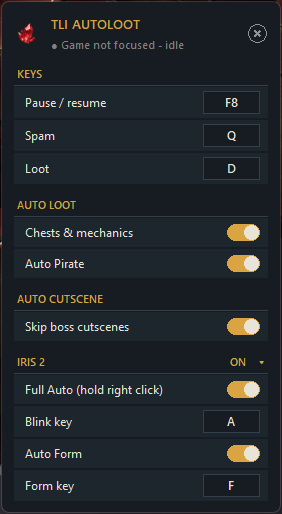

# TLI Autoloot

A small tray helper for Torchlight Infinite. While the game is the active
window it:

- **Spams Q** every 0.1s. It stops while a menu is open, which it detects when
  the flame icon in the top-right HUD disappears.
- **Auto loots:** presses D while the grey finger icon above the D slot is on
  screen, but not while the DPS meter panel is open.
- **Auto Pirate** (off by default): presses D while the purple pirate icon is
  above the D slot, and V while the purple star icon with a V shows in the top
  right. V goes first: while the V icon shows, the pirate icon gets no D.

## IRIS 2

Two optional automations, both **off by default**. Turn them on in the IRIS 2
section of Options and they stay on.

- **Full Auto:** while you hold right click, it runs the right-click skill
  and Blink (A) for you:
  - while the right-click skill has charges, it right clicks every 0.7s
  - at 0 charges, it presses Blink every 0.1s until Blink goes on cooldown
    (the grey stop sign on its icon)
  - once charges are back, it waits 0.3s and right clicks again

  Let go of right click and it stops.

- **Auto Form:** when the green S buff is missing from the top-left buff bar,
  presses Form (F) once. Its stack count doesn't matter.

## Download

Get `TLI-Autoloot.exe` from the
[latest release](https://github.com/orentartour/TLI-Autoloot/releases/latest)
and run it.

The game runs as admin, so the app needs admin too. The first launch asks once
and sets up a scheduled task, so later launches don't show a prompt.

## Hotkey

**F8** pauses and resumes everything. You can rebind it in Options.

## Options



Left-click the tray icon to open the Options panel. From there you can:

- rebind Pause / resume (F8 by default), Spam and Loot: click a key, then
  press the new one (Esc cancels)
- switch chests & mechanics looting and Auto Pirate on or off
- open the IRIS 2 section (click its header) to turn Full Auto and Auto Form
  on or off, and rebind Blink and Form

The default keys are the AZERTY positions of Q and A. On QWERTY, rebind Spam
and Blink once.

Settings are saved in `%APPDATA%\TLI Autoloot`.

## Build

```powershell
.\build.ps1   # TLI-Autoloot.exe on the desktop
```

You need Python 3.13 with pystray, Pillow and PyInstaller. Screen positions
assume the game's UI at 2560x1440; other resolutions are scaled by window
height.
